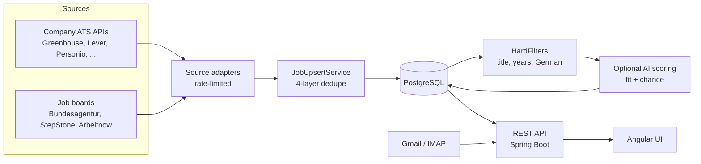

# Job Radar

[](https://github.com/Sawaiz-zip/job-radar/actions/workflows/ci.yml)


[](LICENSE)

A self-hosted job search engine for Germany. Job Radar watches a list of employers and the
big German job boards, pulls every open role into one database, removes the duplicates, and
filters the list down to the jobs you would actually apply for: your field, your experience
level, and the amount of German you speak.

It runs on your own machine. Your filters, your watchlist and your application history stay
in your own database.

## Why it exists

Searching for a job in Germany means checking dozens of company career pages and three or
four job boards, where the same posting shows up several times under slightly different
titles. Many of them ask for fluent German or eight years of experience, but you only find
that out after opening each one. Job Radar does that reading for you. It works out which
applicant tracking system (ATS) each company uses, reads the postings straight from that
system's API, and checks each one against your rules before you see it.

## Features

- **Over 10 sources.** Company boards on Greenhouse, Lever, Personio, Ashby, Recruitee,
  SmartRecruiters, Workday and SuccessFactors, plus the Bundesagentur für Arbeit, StepStone
  and Arbeitnow.
- **Finds company boards on its own.** Add a company by name and Job Radar probes the ATS
  APIs for it. A guessed board is only scanned once independent evidence confirms it,
  because ATS slugs collide (`google.recruitee.com` is somebody's demo board).
- **Deduplication in four layers.** Canonical URL, ATS id, a company + title + city
  fingerprint, and a fuzzy match that goes to a review queue instead of merging on its own.
  Database indexes enforce the uniqueness, not just the code.
- **Filters you set yourself.** Years of experience, German level (A1 to native, in English
  and German phrasing), seniority, student roles, and which job titles count as your field.
  Filtered jobs are hidden, never deleted, so you can always look at the stretch roles.
- **Optional AI scoring.** Give it your CV as YAML and an OpenRouter key, and each job also
  gets a *fit* score (does it match your skills) and a *chance* score (would they invite
  you). A per-run budget caps the cost. Scoring is off by default.
- **Application tracking.** Mark jobs as applied, then connect Gmail (OAuth, read-only) or
  any IMAP mailbox to sort replies into rejections, invitations and acknowledgements.
- **Polite by design.** Public data only. No logins, no LinkedIn, no bot-protection bypass.
  It sends one request per host per second with an honest User-Agent, and records every run
  so you can see when a source breaks.

## Architecture



More detail, including the design decisions and the numbers behind them, is in
[docs/ARCHITECTURE.md](docs/ARCHITECTURE.md).

## Quick start

### Prerequisites

| Tool | Version |
|---|---|
| Java (JDK) | 21 or newer |
| Docker | any recent version, for PostgreSQL |
| Node.js | 18.19 or newer, for the UI |

You don't need to install Maven: the repository includes the Maven wrapper (`./mvnw`).

### 1. Start the database

```bash
docker compose up -d        # PostgreSQL 16 on localhost:5433
```

### 2. Add your settings

```bash
cp config/application-local.example.yml config/application-local.yml
```

Open `config/application-local.yml` and set at least your `contact-email` and your filters.
This file is git-ignored, so your settings never end up in a commit. The next section
explains each setting.

### 3. Start the backend

```bash
./mvnw spring-boot:run      # API on http://localhost:8090
```

On the first start, Flyway creates the schema and the seed files in `seed/` load a starter
list of about 120 German tech employers and a set of search terms.

### 4. Start the UI

```bash
cd frontend
npm install
npx ng serve --proxy-config proxy.conf.json   # http://localhost:4200
```

Open http://localhost:4200 and click **Scan now**. The first full scan takes a few minutes
because it also looks up which ATS each company uses.

## Make it yours

Everything personal goes in `config/application-local.yml`. Spring Boot loads it on top of
the defaults, so you only write the settings you want to change.

### Filters

```yaml
jobradar:
  filters:
    max-years-required: 4        # hide jobs asking for more than 4 years (0 = no limit)
    max-german-level: A2         # hide jobs that need more German than A2
    drop-senior-titles: true     # hide Staff, Principal, Head of, Architect ...
    include-student-roles: false # hide Werkstudent, internships, Ausbildung
    boosts:                      # sort these titles first
      - { pattern: "\\bjava\\b", points: 20 }
```

| Setting | Default | What it does |
|---|---|---|
| `max-years-required` | `0` (no limit) | Hides postings that ask for more years of experience. Reads "5+ years", "mindestens 5 Jahre", "3-5 years" and similar. |
| `max-german-level` | `NATIVE` (no limit) | Hides postings that require more German. Levels: `NONE`, `A1`, `A2`, `B1`, `B2`, `C1`, `C2`, `NATIVE`. Phrases like "verhandlungssicheres Deutsch" or "fluent German" count; a posting that is merely written in German does not. |
| `drop-senior-titles` | `true` | Hides Staff, Principal, Director, Head of, Lead and Architect titles. |
| `include-student-roles` | `false` | Shows Werkstudent, internship and Ausbildung roles. |
| `include-graduate-programmes` | `true` | Keeps graduate and trainee schemes when the posting is technical. |
| `title-must-match` | software engineering | A job title must contain one of these to count as your field. |
| `title-exclude` | sales, marketing, design, ... | Titles with one of these words are a different discipline. |
| `boosts` | none | Title patterns that add (or subtract) points, so the best jobs sort first. |

Anything a filter hides is still in the database: switch on **Stretch roles** in the UI to
see it, along with the reason it was hidden.

### Searching a field other than software

The default title gate is built for software engineering. For another field, replace it:

```yaml
jobradar:
  filters:
    title-must-match: ["maschinenbau", "mechanical", "konstrukt", "entwicklungsingenieur"]
    title-exclude: ["sales", "vertrieb", "marketing", "recruiter"]
  ba:
    queries: ["Maschinenbauingenieur", "Konstrukteur"]
  stepstone:
    keywords: ["maschinenbauingenieur", "konstrukteur"]
```

Then edit the search terms in the UI's tag bar (or in `seed/search_terms.csv`) to match.

### Your watchlist

`seed/companies.csv` is a starter list of employers. To keep your own list without editing
the shared one, copy the folder and point Job Radar at the copy:

```bash
mkdir -p seed/local && cp seed/*.csv seed/local/    # seed/local/ is git-ignored
```

```yaml
jobradar:
  seed-dir: "seed/local"
```

You can also add companies from the UI. Job Radar then looks up their ATS on its own.

### Optional: AI scoring

1. Copy `config/profile.example.yaml` to `config/profile.yaml` and fill in your CV.
2. Put your [OpenRouter](https://openrouter.ai) key in a `.env` file in the project root:
   `OPENROUTER_API_KEY=sk-or-...`
3. Turn it on:
   ```yaml
   jobradar:
     llm:
       scoring-enabled: true
       ideal-match: "backend roles in Python or Go, junior to mid level"
   ```

A cheap model scores a job for about $0.0002. Each run stops at `budget-per-run`, and
after five jobs it projects the run's total cost and stops early if that would pass
`max-estimated-cost`.

### Optional: reading replies

Job Radar can read your mailbox to see which applications got an answer. It supports
**Gmail** (OAuth, read-only scope) and **IMAP** (any provider, with an app password). Setup
steps are in [docs/MAIL.md](docs/MAIL.md).

Every setting is described in [docs/CONFIGURATION.md](docs/CONFIGURATION.md).

## Development

```bash
./mvnw test                               # backend unit tests (no database needed)
cd frontend && npx ng build               # production build of the UI
```

GitHub Actions runs both on every push and pull request. Database changes are Flyway
migrations in `src/main/resources/db/migration/`; never edit one that has already been
released, add a new one instead.

```
src/main/java/com/jobradar
 ├─ api          REST controllers, job filtering, tag matching
 ├─ application  applications you have sent
 ├─ company      employer registry, ATS detection and verification
 ├─ config       HTTP client, per-host rate limiter
 ├─ dedupe       URL canonicalizer, normalizer, the single upsert path
 ├─ ingest       scan orchestration, seed import
 ├─ mail         Gmail and IMAP reply reading and classification
 ├─ match        filters, German level detection, AI scoring
 └─ source       one adapter per ATS or job board
frontend/        Angular 18 UI
seed/            starter employer list and search terms
config/          example settings and profile (your own copies are git-ignored)
```

Contributions are welcome; see [CONTRIBUTING.md](CONTRIBUTING.md). New source adapters are
the most useful kind.

## Responsible use

Job Radar only reads public job data. It sends one request per host per second, identifies
itself honestly, and leaves out sources that would need a login or a way around bot
protection (LinkedIn and Indeed among them). Please keep it that way if you change it, and
set your `contact-email` so a site operator can reach you.

## License

[MIT](LICENSE)
