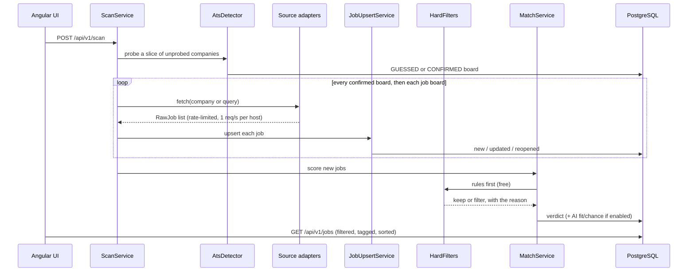

# Architecture

Job Radar is a Spring Boot 3 application on Java 21 with PostgreSQL 16 (schema managed by
Flyway) and an Angular 18 front end. It is a modular monolith: one deployable, with packages
split along the stages a job goes through.

## Finding a company's job board

Most career pages render their ATS link with JavaScript, so reading the page finds the
board only some of the time. Job Radar asks the ATS APIs directly whether a tenant matching
the company name exists instead. This has a much higher hit rate (61 of 126 companies
against 1 of 12 when scraping pages, measured), but slugs collide:

- `google.recruitee.com` is an unrelated demo board that even reports the name "Google";
- `amazon.jobs.personio.de` is a Lorem-ipsum test tenant;
- `meta` on Recruitee belongs to a university.

So **a guessed tenant is never scanned**. It becomes `CONFIRMED` only when something
independent agrees, either because the board reports a matching company name or because the
company's own website links to it (`DetectionVerifier`). Everything else waits in
**Confirm boards** for one click. The evidence may never come from the ATS itself: an early
version wrote the probe URL into `careers_url`, then "verified" the guess against itself.

Detection runs as part of every full scan (`jobradar.detect.per-scan` companies at a time,
never-probed first), so companies that first appeared on a job board get their own board
looked up too.

## Never storing a job twice

Every write goes through `JobUpsertService`, and the layers are tried cheapest first:

| Layer | Key | Enforced by |
|---|---|---|
| L1 | canonical URL | unique index on `job_source.canonical_url` |
| L2 | (source type, tenant, external id) | unique index |
| L3 | fingerprint: company + normalized title + city | partial unique index on open jobs |
| L4 | fuzzy title similarity | **review queue only, never auto-merged** |

One job has many `job_source` rows, so the same posting seen on an ATS and on a job board
stays one job with two sources. A closed job that reappears inside the repost window
(`jobradar.repost-window-days`) reopens the original row instead of creating a new one.

L4 never merges on its own, because a wrong merge hides a real job and nothing tells you.

Board sources return many employers per call, so each job's company is resolved by
normalized name (`CompanyResolver`), with legal forms and requisition tails stripped:
"Amazon Web Services Development Center Germany GmbH R28" must not become a second Amazon.

## Filtering: cheapest first, never deleting

| Gate | Cost | Drops |
|---|---|---|
| Title gate | free | titles outside your field (`title-must-match`, `title-exclude`) |
| Rules on the posting text | free | too many years, too much German, too senior, student roles |
| The model's own answer (optional) | about $0.0002 per job | German or years that only became clear once the text was read |

A filtered job keeps its row and its reason, and the **Stretch roles** switch shows it.
German postings routinely ask for more than they will settle for, so hiding is the right
default and deleting would not be.

The title gate is a *positive* list (the title must name a job in your field) because a
blocklist has to anticipate everything else, from "Junior Cook/Koch" to "Packaging
Excellence Engineer". It deliberately has **no word boundaries**: German glues nouns
together, and `\bentwickler\b` never matches "Softwareentwickler", the most common title on
the Bundesagentur board.

German level detection (`GermanRequirement`) only trusts explicit requirements, in English
and German ("verhandlungssicher", "fließend", "C1", "fluent German"). A posting written in
German often names English as the working language, so the language of the ad alone
decides nothing.

## Two scores

When AI scoring is on, each job gets two separate numbers:

- **fit**: does the job match the candidate's real skills;
- **chance**: would they realistically get an interview (years asked, German, seniority,
  visa restrictions).

A Staff role at a well-known AI lab can be high fit and near-zero chance. Only the second
number tells you where an afternoon of writing an application is worth spending. Cost is
capped per run, and after a five-job sample the run's total is projected and stopped early
if it would pass `max-estimated-cost`.

## Sources

| Source | Kind | How it is read |
|---|---|---|
| Greenhouse, Lever, Personio, Ashby, Recruitee, SmartRecruiters, Workday, SuccessFactors | per company | public board APIs and feeds |
| Bundesagentur für Arbeit | board | the public job search API; the only way to reach many Mittelstand employers |
| StepStone | board | the result-list JSON its pages embed, plus schema.org `JobPosting` on detail pages |
| Arbeitnow | board | its public JSON feed |

The Bundesagentur and StepStone search lists are kept short on purpose. Both match loosely,
and a single broad term like "Kubernetes" brought in 779 unrelated ads against 156 relevant
ones. The Bundesagentur result list carries no description, so details are fetched only for
postings whose title already passed the title gate.

Indeed is deliberately absent: it answers non-browser clients with a bot challenge, and
reaching it would mean a bypass. LinkedIn is absent for the same reason.

`GET /api/v1/sources` gives a verdict per source from its latest runs. A run that returns
zero jobs is `EMPTY`, never `OK`, so a source that silently broke is visible.

## Front end

The filter bar is one state object fed through a single `switchMap` stream: typing is
debounced, clicks are not, and a slow older response can never overwrite a newer one. Tag
changes go through a `concatMap` queue so they apply in click order. Tags are matched in
Java (`TagMatcher`) rather than with one Postgres regex per word, which took a full list
from 6 to 7.5 seconds down to 0.14 seconds.

## Dates

`posted_at` is nullable on purpose: Greenhouse reports `updated_at`, and Personio often
reports nothing. Sorting uses `COALESCE(posted_at, first_seen_at)` and the UI marks which of
the two it shows.
